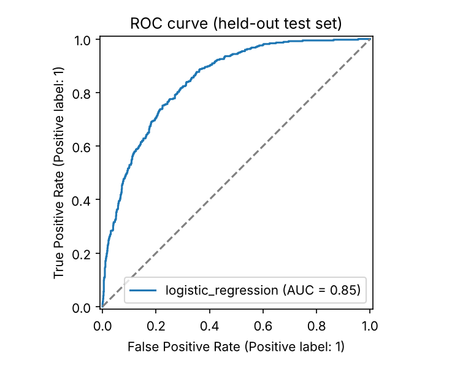
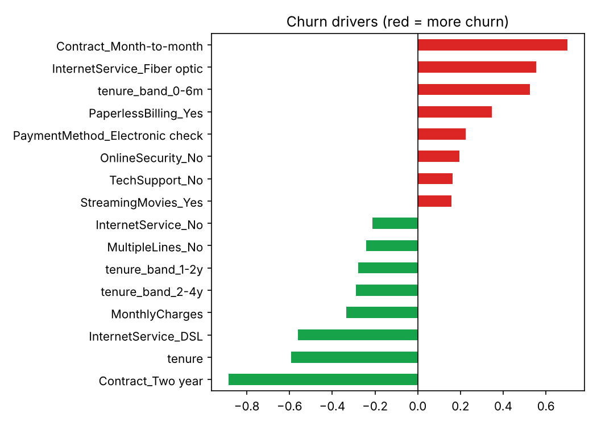

# Customer Churn Predictor

An end-to-end machine-learning project that predicts which telecom customers are likely to leave, explains why, and serves predictions in a **Streamlit** app.

  

**Dataset:** [IBM Telco Customer Churn](https://github.com/IBM/telco-customer-churn-on-icp4d), with 7,043 customers and a 26.5% churn rate.

## Results

Three models compared with 5-fold stratified cross-validation on the training set (80%):

| Model | CV ROC-AUC |
|---|---|
| Logistic Regression | 0.847 ± 0.011 |
| Random Forest | 0.846 ± 0.009 |
| Gradient Boosting | 0.839 ± 0.008 |

The best model (**logistic regression**) on the untouched 20% test set:

| Metric | Score |
|---|---|
| ROC-AUC | **0.845** |
| PR-AUC | 0.652 (baseline 0.265) |
| Recall (churners caught) | 71.1% |
| Precision | 55.8% |
| F1 | 0.625 at threshold 0.593 |

The simple, interpretable logistic regression matches the tree ensembles here, so I kept it. Its coefficients double as an explanation of churn drivers. The decision threshold is tuned for F1 on **out-of-fold** predictions, so the test set is never used for tuning.

<p float="left">
  
  
</p>

## Key insights (from the [EDA notebook](notebooks/01_eda.ipynb))

- Month-to-month contracts churn far more than annual contracts
- Risk is highest in the first six months of tenure
- Customers paying by electronic check churn the most
- Each extra add-on service (security, backup, tech support…) lowers churn

## Project structure

```
src/churn/data.py       download + clean (fixes blank TotalCharges for tenure-0 customers)
src/churn/features.py   feature engineering + ColumnTransformer (shared by training and the app)
src/churn/train.py      CV model comparison, threshold tuning, metrics, figures
notebooks/01_eda.ipynb  exploratory analysis with business takeaways
app.py                  Streamlit risk scorer with suggested retention actions
tests/                  pytest unit tests for feature engineering
```

## Run it

```bash
python -m venv .venv && source .venv/bin/activate
pip install -r requirements.txt
python -m src.churn.train      # downloads data, trains, writes models/ and reports/
streamlit run app.py
pytest
```
